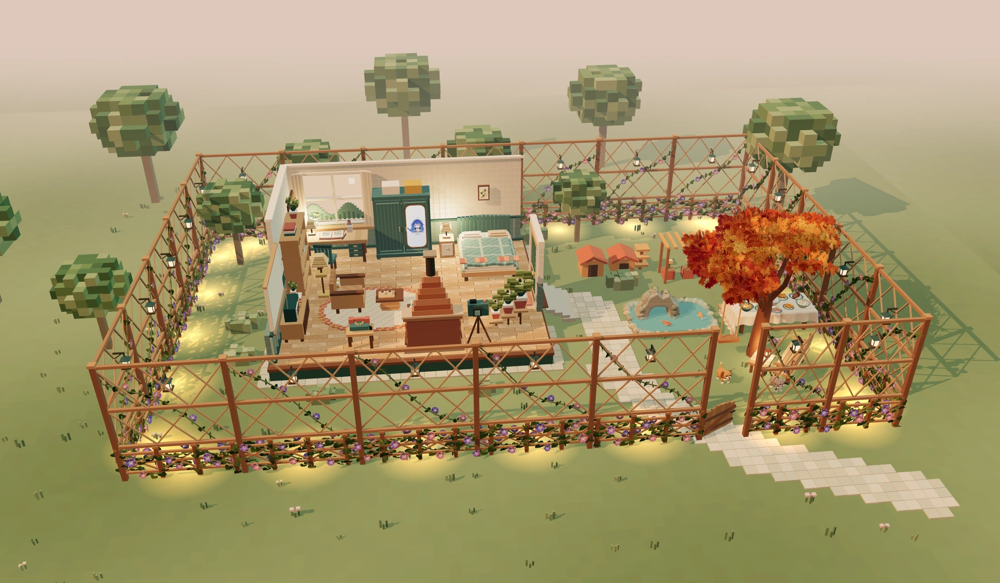
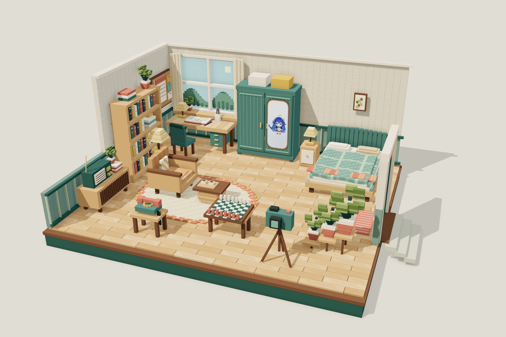

# 大肥鱼的小屋

可以在浏览器中走近大肥鱼的书桌、衣柜、床边和院子，切换八套衣服，查看穿衣镜，或单独导出带骨架的角色。独立预览使用本地生成的示范动作和猫狗路径。屏幕上的动作记录只在本次预览中存在。

## 资产图集

[](previews/panoramas/cottage-at-dusk.webp)

| 小屋室内 | 篱下小院 |
| --- | --- |
| [](previews/README.md#小屋室内) | [](previews/README.md#篱下小院) |

[浏览完整图集](previews/README.md) · [屋内与院中 360° 全景](previews/README.md#360-全景) · [八套穿搭与布料特写](previews/README.md#大肥鱼的衣柜)

## 本地预览

使用 Node.js 22 或更新版本，在仓库根目录运行下列命令。

```sh
npm ci
npm run preview
```

打开终端打印的地址。页面顶部可换装和选择动作，场景中的「照镜子」展示对应的穿着，「看小院」可以选择动物和庭院中的位置。「跟随」可以把镜头移到角色附近。拖动或滚轮可以调整镜头。

## 模型

- [大肥鱼与默认女仆装](assets/大肥鱼.glb) 和 [无服饰基础身体](assets/大肥鱼-基础身体.glb) 各含 16 段动画。身体、手臂、头发、眼睛和尾巴属于角色。衣料、穿搭配饰和蕾丝单独绑定。
- [小屋室内](assets/小屋室内.glb) 包含家具、默认装束的穿衣镜和灯光，从书桌、衣柜到床铺可按节点选择。室内体素使用 glTF 的 `EXT_mesh_gpu_instancing`，导入器需要支持该扩展。
- [篱下小院](assets/篱下小院.glb) 包含池塘和三条金鱼、猫狗、花架、枫树、秋千、餐桌与壁炉。室内和庭院 GLB 保存的是场景快照。动物路线、日照和家具交互由网页源码驱动。
- 两个场景和九个独立角色文件可在 [v1.0.0 发布页](https://github.com/PekolandBBQ/dafeiyu-cottage-3d/releases/tag/v1.0.0) 获取，也可用下方命令生成。

## 重新构建

```sh
npm run build
npx playwright install chromium
npm test
npm run export -- models
npm run export -- wardrobe
npm run export -- scenes
npm run export -- mirror
```

`build` 将静态网页写入 `dist/`。`test` 启动本地服务器和 Chromium，打开实际房间、换装、穿衣镜和庭院，并渲染全部八套穿搭。`export` 使用同一套 Three.js 源码和已安装的 Chromium。已有 Google Chrome 时，也可设置环境变量 `PLAYWRIGHT_CHANNEL=chrome`。浏览器需支持 WebGL 2。

安装上述依赖和 Chromium 后，运行 `node tools/check-rig.mjs` 可用实际角色检查蕾丝在不同帧率下的回弹、瞬移复位，以及换装时身体与饰边的分离。

| 参数 | 生成内容 |
| --- | --- |
| `models` | 默认女仆装、无服饰基础身体，写入 `assets/` |
| `wardrobe` | `assets/release/dafeiyu-{base,maid,press,summer,star,sailor,winter,sleep,rain}.glb` |
| `scenes` | 室内和院落两个独立 GLB，写入 `assets/` |
| `mirror` | 以固定镜头为八套服装重新拍摄全身像，写入 `assets/mirror-portraits.json` |

不带参数时，导出默认角色、素体、室内、庭院及八张镜像。镜像更新后再次运行 `npm run build` 即可打包新图。

`src/panels/` 包含房间、角色、服装、蕾丝动力学、院落、动物和家具的建模代码。`assets/衣柜参考图/` 保存服装设定图。`tools/bake-outfit-surfaces.py` 可用 Python、Pillow、NumPy 和 OpenCV 从这些图片重做服装表面与脸部细节。沿用桌宠动作或外观投影时，`bake-dsh-motion.py` 和 `bake-dsh-surfaces.py` 额外需要各自的原始动作视频、相应转身素材及 FFmpeg。常规网页与 GLB 构建直接读取仓库中的烘焙结果。原转身动图的尺寸、帧数及校验值见[来源说明](THIRD_PARTY_NOTICES.md)。

从原始输入重做贴图与动作时，可以按下列顺序执行。将视频目录、FFmpeg 和动图的示例路径替换为本机路径。

```sh
python -m pip install pillow numpy opencv-python
python tools/bake-dsh-surfaces.py /path/to/videos /path/to/ffmpeg /path/to/turnaround.gif assets/whale-toon-face.json
python tools/bake-dsh-motion.py /path/to/videos /path/to/ffmpeg assets/dsh-motion.json
python tools/bake-outfit-surfaces.py
npm run export -- models wardrobe scenes mirror
```

## 署名与使用

大肥鱼的形象衍生自「溟月」及女仆鲸鱼娘／DeepSeek 版本。原型作者为**上善无形**，女仆鲸鱼娘版本的设计者为 **ZipZipPipe**。该项目重新制作了三维造型、骨架、服装和动作表现，采样参考了 **merzlin** 发布的 shenshen 桌宠 4.2.1。角色形象、穿搭、贴图和角色 GLB 按 **CC BY-NC-SA 4.0** 使用，需要署名、仅限非商业用途，演绎作品采用相同许可。[上善无形](https://space.bilibili.com/4456176) · [ZipZipPipe](https://space.bilibili.com/4168597) · [作者声明](https://www.bilibili.com/opus/1247156596114456581) · [桌宠上游](https://github.com/PC2005-cloud/dsh-pet)

场景及相关项目代码按 **AGPL-3.0** 分发。原小屋项目由 **menglimi** 及贡献者开发。桌宠上游的程序代码采用 MIT，Three.js、esbuild 和 Playwright 各自保留原许可。逐项来源和获取许可条款见 [第三方说明](THIRD_PARTY_NOTICES.md)。
