# 大肥鱼小屋资产图集

这些画面取自 v1.0.0 的公开三维模型。点图可查看原尺寸。[模型下载](https://github.com/PekolandBBQ/dafeiyu-cottage-3d/releases/tag/v1.0.0) · [来源与许可](../THIRD_PARTY_NOTICES.md)

## 小屋与院子

[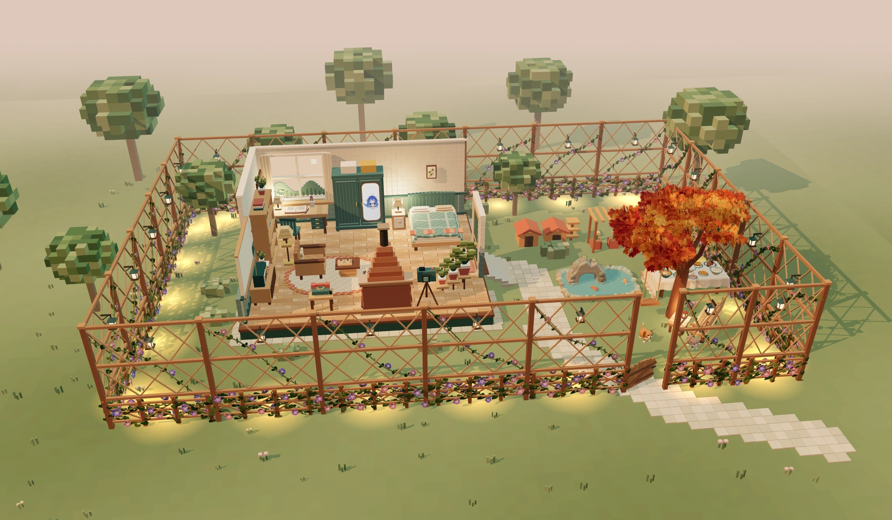](panoramas/cottage-at-dusk.webp)

从篱门往里看，左侧是小屋，右侧是鱼池和枫树下的餐桌。

## 360° 全景

两张图分别从屋内地毯旁和院中石径取景。原图均为 4096 × 2048 的等距柱状投影，可在支持这种格式的全景查看器中环视。

**站在小屋里**

[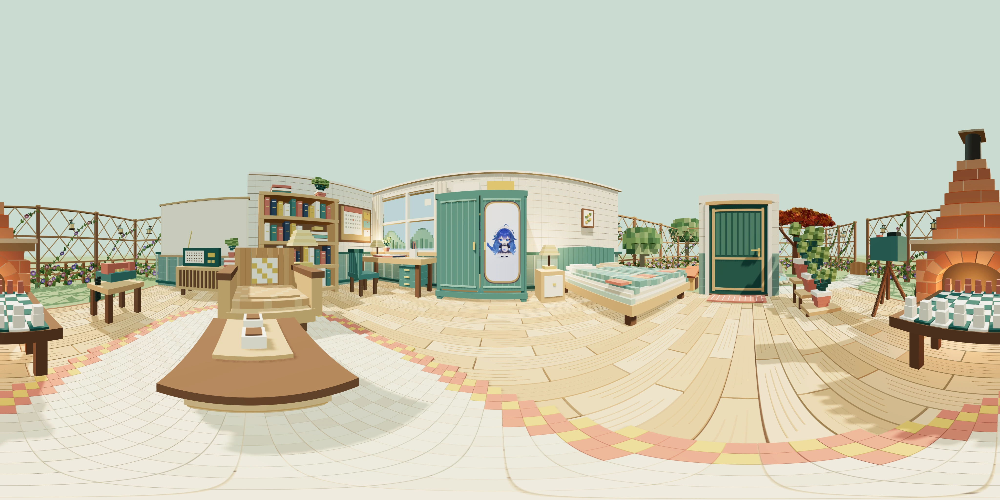](panoramas/room-360.webp)

**站在院中石径上**

[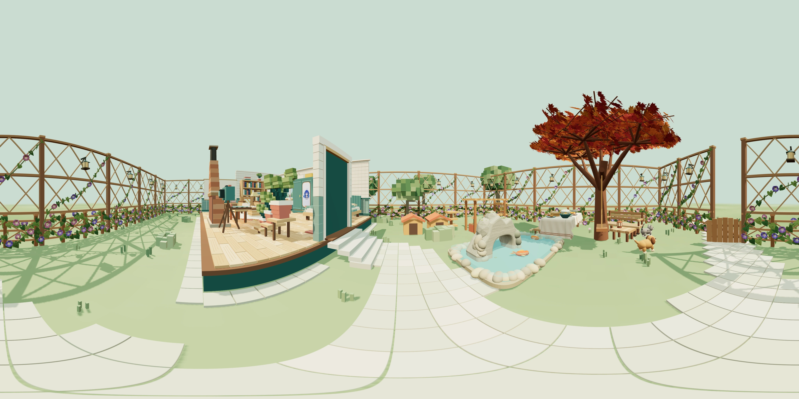](panoramas/garden-360.webp)

## 小屋室内

[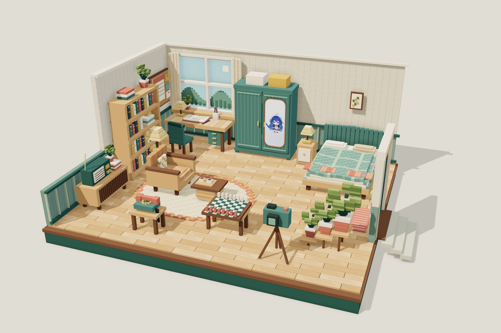](interior/room-overview.webp)

| 窗边书桌 | 阅读角 |
| --- | --- |
| [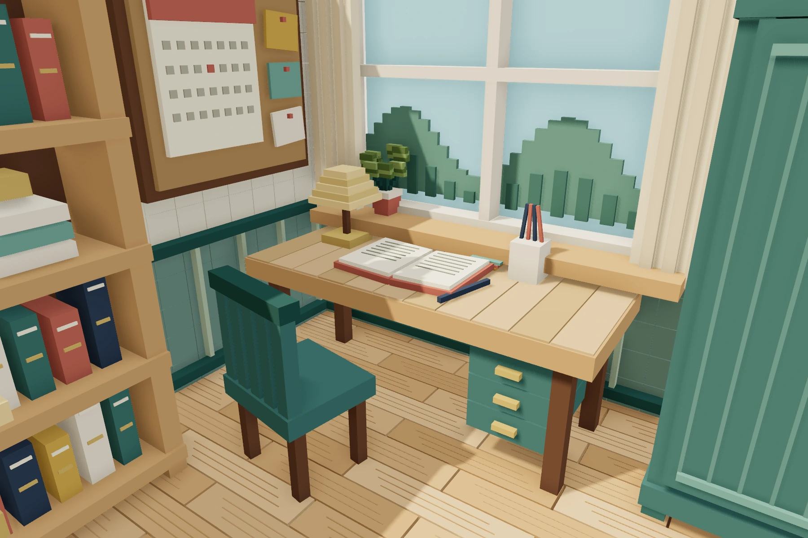](interior/window-desk.webp) | [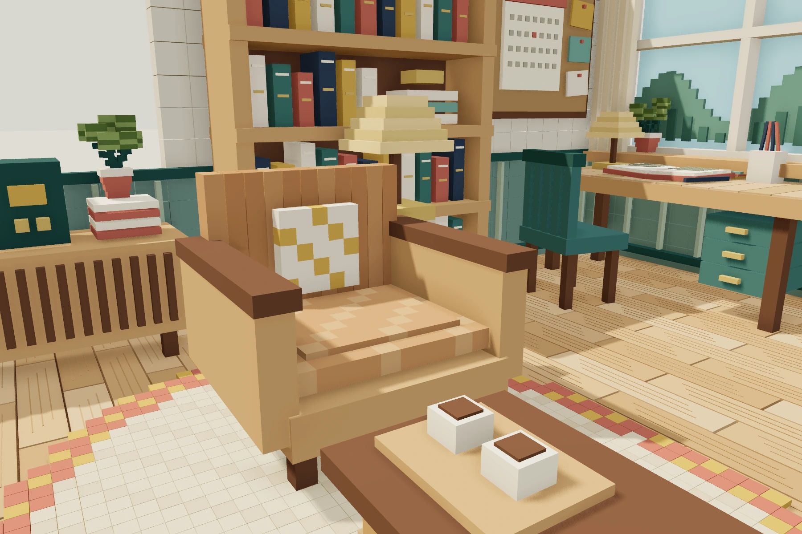](interior/reading-corner.webp) |

| 衣柜穿衣镜 | 床头 |
| --- | --- |
| [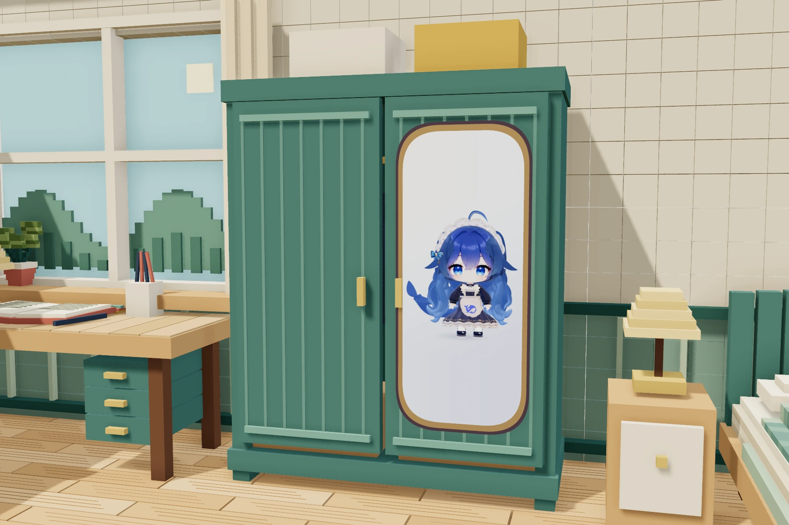](interior/wardrobe-mirror.webp) | [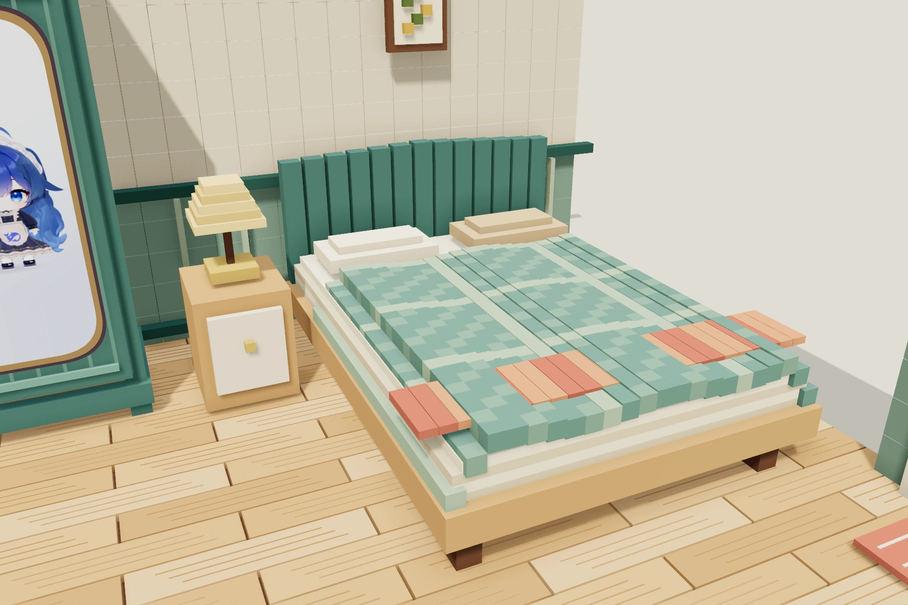](interior/bedside.webp) |

## 篱下小院

[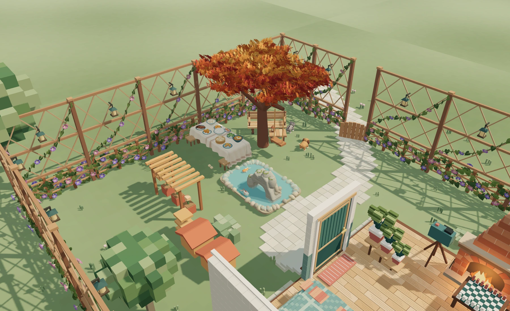](yard/overview.webp)

| 枫树下的餐桌 | 金鱼池 |
| --- | --- |
| [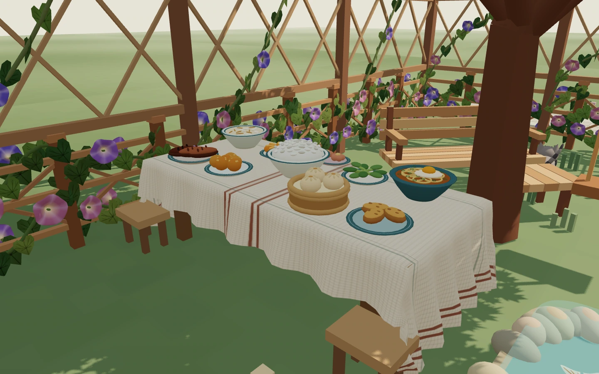](yard/maple-table.webp) | [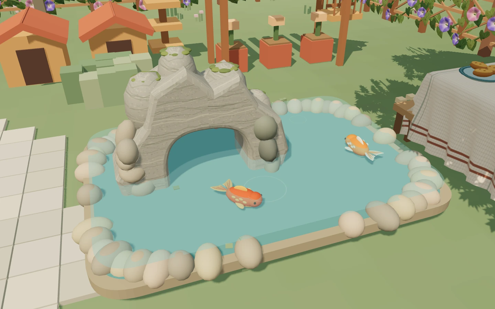](yard/pond.webp) |

| 长椅旁的猫和狗 | 牵牛花篱门 |
| --- | --- |
| [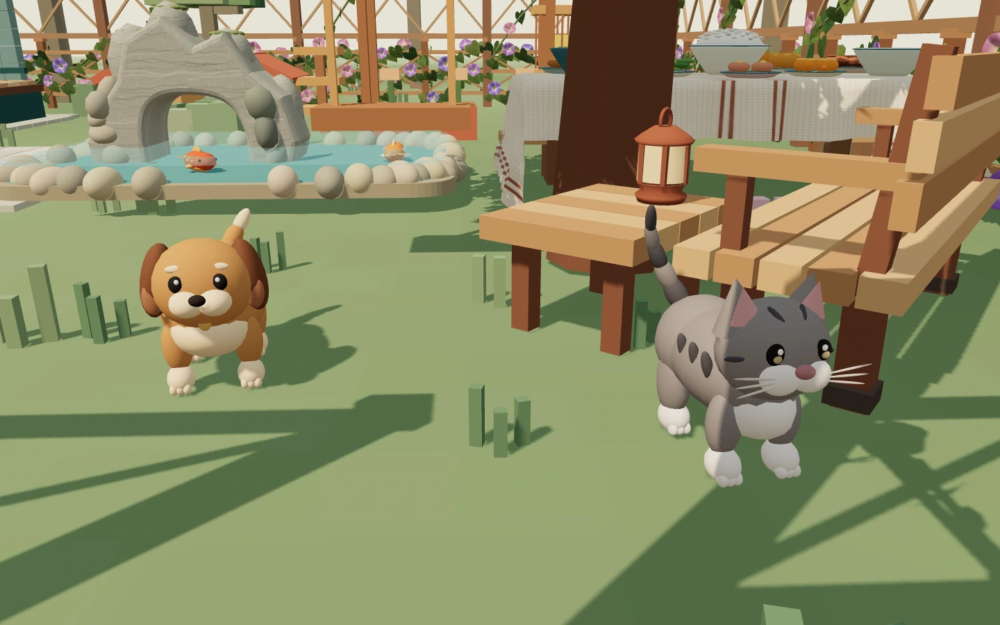](yard/cat-and-dog.webp) | [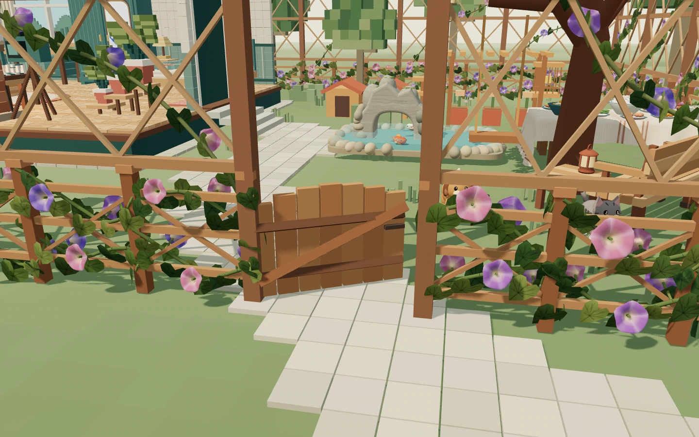](yard/gate.webp) |

## 大肥鱼的衣柜

[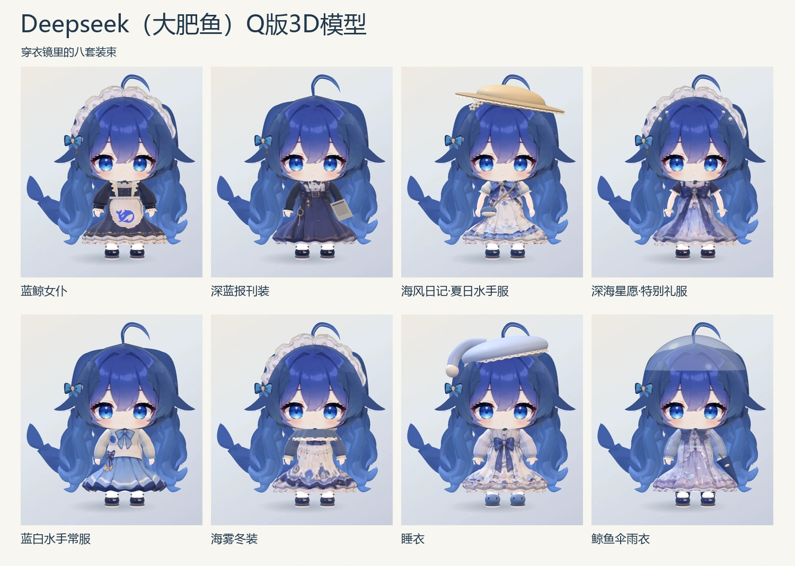](wardrobe/outfits.webp)

**海风日记 · 夏日水手服**

[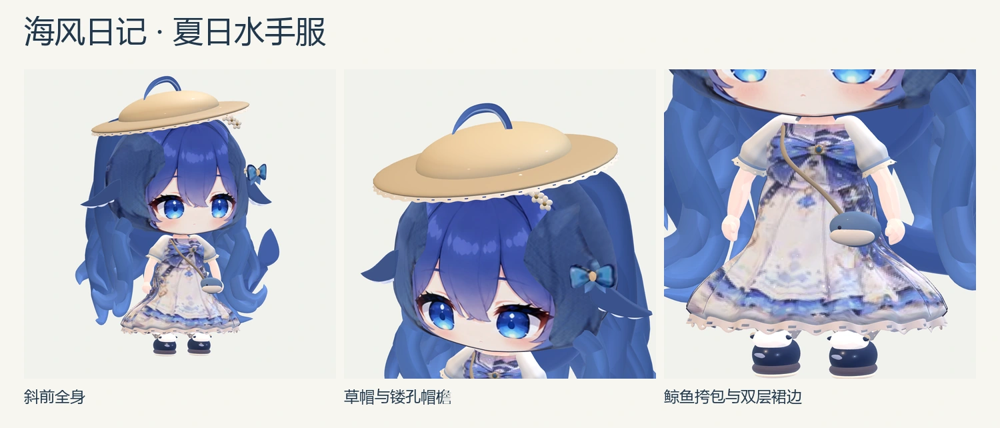](wardrobe/summer-details.webp)

**蓝鲸女仆**

[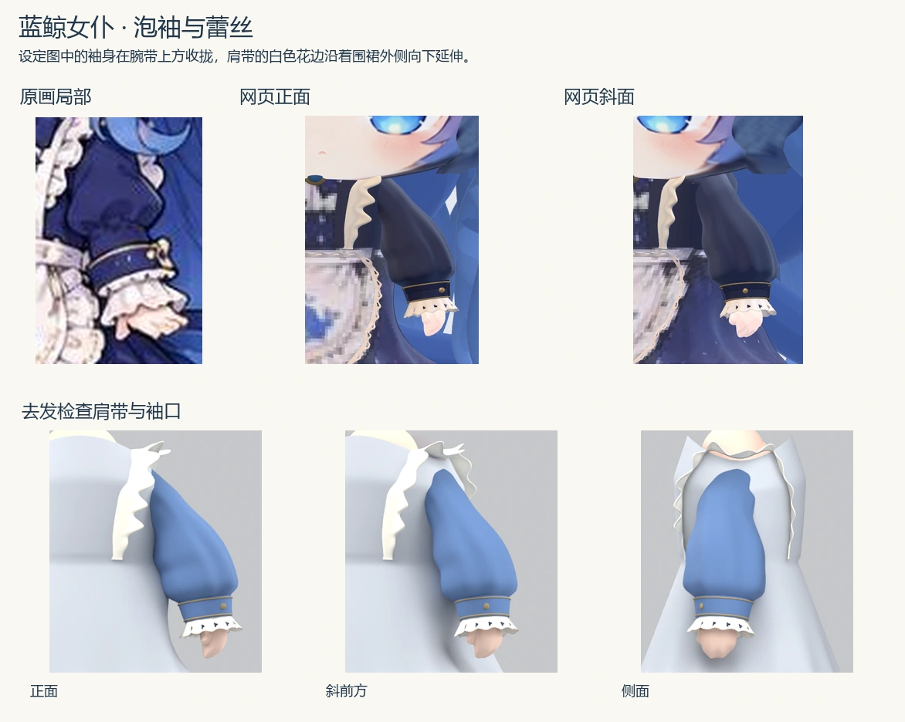](maid-sleeves.webp)

[查看走动与收步时袖口的摆动](maid-walk.webp)
